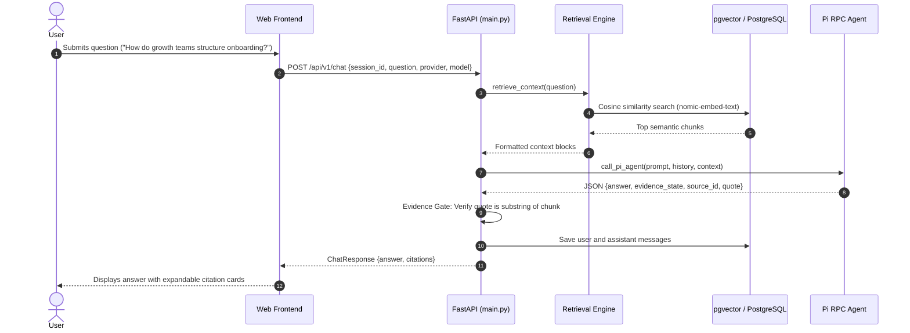

# Product Requirements Document (PRD)
## The Lenny Growth Assistant

**Project:** Forward Deployed Engineer Take-Home Assignment | Oogway Labs  
**Repository:** [https://github.com/mkpg/lenny-growth-assistant](https://github.com/mkpg/lenny-growth-assistant)  
**Transcript Source:** [Lenny’s Podcast Transcript Collection](https://github.com/ChatPRD/lennys-podcast-transcripts)  
**Submission Due Date:** 12 October 2026 EOD  

---

## 1. Executive Summary & Engagement Scenario

The Lenny Growth Assistant is a full-stack, conversational AI web application designed for product management, growth, and startup leadership teams. The client team asked for an internal assistant capable of turning unstructured discussions from *Lenny’s Podcast transcripts* into grounded, operational knowledge.

General-purpose chatbots frequently produce plausible-sounding statements, quotations, or metrics that are absent from the underlying source material. To address this trust problem, the application combines a vector-retrieval pipeline with an **Evidence Gate**, configurable **local (Ollama) and cloud model orchestration**, a specialized **Ship 30 for 30 content creation skill**, and a native **dual-format Artifact Viewer** with iframe isolation.

---

## 2. Forward Deployment Brief

### 2.1 Primary User and Problem Statement
- **Primary Users:** Growth Product Managers, Heads of Growth, Founders, and Product Marketing Managers.
- **The Core Problem:** Practical growth discussions are dispersed across hundreds of hours of podcast audio and transcript files. Finding specific advice on topics like activation benchmarks or growth team structure requires manual searching, while standard LLMs often invent facts or misattribute quotes.
- **Job-to-Be-Done:** *"When researching growth tactics, I want to query expert discussions from Lenny's guests, inspect the underlying transcript evidence, and turn relevant takeaways into structured essays, checklists, or interactive HTML prototypes."*

### 2.2 Success Metrics: Target vs. Measured Outcomes

To provide clear operational visibility, proposed targets are separated from measured outcomes:

| Metric Category | Target Metric (Objective) | Measured / Verified Outcome | Status |
|---|---|---|---|
| **Citation Verification** | $100\%$ of cited quotes matched to retrieved transcript chunks. | Substring verification checks extracted quotes against chunk text; mismatched quotes are flagged. *Note: Verifying a quote does not prove that all surrounding text in the answer is grounded.* | Implemented & Verified in Evidence Gate |
| **Automated Test Reliability** | $100\%$ pass rate on the regression test suite. | **116 passed, 1 warning in 73.72s** across 11 test modules (`pytest -q`, run 12 Oct 2026). | Verified by automated test suite |
| **Response Latency** | Time to First Token (TTFT) $< 5.0\text{s}$ on local model. | Hardware-dependent. Local latency varies significantly based on host CPU/GPU, RAM allocation, and model size. Cloud latency depends on provider network availability. | Hardware-Dependent |
| **In-App Artifact Usability** | $100\%$ of supported artifacts render in-app without external tabs. | Markdown renders via `marked.js`; HTML renders via sandboxed `<iframe>`. Both formats open directly in the viewer modal. | Implemented & Verified |
| **Session Boundary Enforcement** | Zero cross-session artifact leakage. | Database queries enforce session ownership; cross-session artifact retrieval returns HTTP `403 Forbidden`. | Verified by automated tests |

### 2.3 Important Assumptions
1. **Evaluator Environment:** The evaluator runs the solution on a workstation with Python 3.10+, Node.js (for Pi CLI), Ollama (for local evaluation), and access to a PostgreSQL instance with pgvector.
2. **CLI Discovery:** The application discovers the Pi CLI via the `PI_CMD_PATH` environment variable or system `PATH`.
3. **Corpus Baseline:** The current database snapshot used during development contains 3 representative podcast episodes (~178 chunked segments). This baseline supports testing without requiring large multi-gigabyte vector store downloads.

### 2.4 Scope Choices

#### Included in Scope:
- **FastAPI REST Backend:** Health probes (`/health`, `/ready`), chat endpoint (`/api/v1/chat`), and artifact management endpoints.
- **PostgreSQL + pgvector:** Relational storage for sessions, messages, and artifacts alongside dense vector similarity search.
- **Model Configuration Layer:** Toggle between local Ollama (`qwen2.5:3b`, `qwen3:4b`) and configured cloud providers (Gemini, Claude) via Pi CLI RPC.
- **Ship 30 for 30 Skill:** Dedicated prompt skill generating ~1,250-word structured essays with narrative hooks and skimmable formatting.
- **Dual-Format Artifact Viewer:** In-app modal rendering both formatted Markdown and sandboxed HTML/CSS documents.
- **Artifact Library:** Multi-artifact persistence per session, deduplication, history browsing, and raw `.md` / `.html` downloads.

#### Intentionally Excluded from Scope:
- **Arbitrary File Upload & OCR:** Excluded because the customer requirement is specifically focused on the *Lenny’s Podcast* transcript collection.
- **Automated Newsletter Scraping:** Excluded in favor of a deterministic CLI ingestion script (`scripts/ingest.py`) to maintain a controlled evaluation environment.
- **Complex Authentication Systems:** Excluded in favor of cryptographically generated UUID session identifiers to keep evaluation setup simple while maintaining session isolation.

### 2.5 Risks and Technical Trade-offs

| Risk Factor | Severity | Engineering Mitigation | Trade-off / Limitation |
|---|---|---|---|
| **Hallucination & Fabrication** | High | Multi-stage Evidence Gate: Parses `evidence_state`, `source_id`, and `quote`, verifying that `quote` is a substring of the retrieved chunk. | Exact-quote validation confirms quotation accuracy, but does not guarantee semantic accuracy for paraphrased claims. |
| **Local Model Resource Constraints** | Medium | Configured lightweight model (`qwen2.5:3b`) with optimized context windows. | Smaller parameter size allows local offline execution on standard laptops, but complex reasoning may be less nuanced than high-parameter cloud models. |
| **Untrusted HTML Rendering** | High | HTML rendered in an `<iframe>` with `sandbox="allow-scripts"` (strictly omitting `allow-same-origin`) and Blob URL CSP. | Script execution inside the iframe is permitted for interactive components, but parent storage and DOM are isolated. Security depends on browser sandbox compliance. |
| **Agent CLI Tool Interception** | Medium | Appended `--exclude-tools *` to all Pi CLI invocations. | Stripped Pi of filesystem and terminal tools so it operates strictly as a conversational completion engine. |

---

## 3. Functional Requirements

### 3.1 Grounded Conversational Assistant
- **FR-1.1:** Accept natural language questions regarding product management, growth, and team building.
- **FR-1.2:** Retrieve relevant transcript chunks using cosine distance search with a defined threshold.
- **FR-1.3:** Display citation cards containing speaker name, episode title, and verified excerpt.
- **FR-1.4:** Acknowledge when the available transcripts do not contain sufficient evidence for a question.

### 3.2 Ship 30 for 30 Content Skill
- **FR-2.1:** Dedicated skill encoded in `skills/ship30_for_30/SKILL.md` to guide essay generation.
- **FR-2.2:** Target approximately 1,250 words with:
  - An opening hook and narrative progression.
  - Skimmable formatting with headings, bullet points, and bold emphasis.
  - Practical takeaways grounded in the transcript knowledge base.

### 3.3 Artifact Generation & Dual-Format Viewer
- **FR-3.1:** Generate Markdown documents or complete HTML/CSS snippets based on user request.
- **FR-3.2:** Display **Preview Markdown Artifact** or **Preview HTML Artifact** action buttons in the chat message.
- **FR-3.3:** Render Markdown documents via `marked.js` with typography styling in the viewer modal.
- **FR-3.4:** Render HTML documents inside an isolated `<iframe>` with sandbox attributes.
- **FR-3.5:** Support direct file download for both `.md` and `.html` formats.

### 3.4 Artifact Library & Session Persistence
- **FR-4.1:** Persist generated artifacts to the `artifacts` table in PostgreSQL.
- **FR-4.2:** Support multiple distinct artifacts within a single session without overwriting previous items.
- **FR-4.3:** Avoid creating duplicate records when identical content is generated in the same session.
- **FR-4.4:** Provide a top-header **Artifacts (N)** button that increments dynamically as artifacts are saved.
- **FR-4.5:** Reopen saved artifacts from history directly from database records without re-invoking the model.
- **FR-4.6:** Enforce session boundaries, responding with HTTP `403 Forbidden` if cross-session access is attempted.

---

## 4. Primary User Flows

### Flow 1: Conversational Q&A with Citation Inspection


### Flow 2: Artifact Generation, Preview, and Download
```mermaid
sequenceDiagram
    autonumber
    actor User
    participant UI as Web Frontend
    participant API as FastAPI (main.py)
    participant DB as PostgreSQL
    participant Viewer as In-App Artifact Viewer

    User->>UI: "Create an HTML activation dashboard"
    UI->>API: POST /api/v1/chat
    API->>API: Detects complete HTML artifact in response
    API->>DB: create_artifact(session_id, title, content, type="html")
    API-->>UI: ChatResponse {artifact_id, artifact_title, artifact_type: "html"}
    UI->>UI: Renders "Preview HTML Artifact" button; increments Header "Artifacts (N)"
    User->>UI: Clicks "Preview HTML Artifact"
    UI->>Viewer: Opens modal; loads Blob URL into sandboxed iframe
    Viewer-->>User: Renders interactive, isolated dashboard
    User->>Viewer: Clicks "Download"
    Viewer->>API: GET /api/v1/artifacts/{id}/download?session_id={id}
    API-->>User: Downloads "activation_dashboard.html"
```

---

## 5. Acceptance Test Matrix

| Req ID | Test Description | Verification Method | Pass Criteria |
|---|---|---|---|
| **AC-1** | Liveness & Readiness Probes | Automated (`GET /health`, `/ready`) | Returns HTTP 200 with `database: connected`, `pgvector: installed`. |
| **AC-2** | Unsupported Question Handling | Automated & Manual | Assistant acknowledges lack of evidence rather than inventing facts. |
| **AC-3** | Citation Substring Verification | Automated Unit Test | Quoted text matches an exact substring of the retrieved chunk. |
| **AC-4** | Local Ollama Execution | Manual Test | Answers stream or return from local Ollama service without cloud credentials. |
| **AC-5** | Ship 30 for 30 Structure | Automated Test | Output reflects hook, subheads, and structured takeaway format. |
| **AC-6** | HTML Sandboxing | Browser Audit & Unit Test | Iframe uses `sandbox="allow-scripts"` without `allow-same-origin`. |
| **AC-7** | Markdown Formatting | Browser Audit | Markdown renders headings, lists, and tables via `marked.js`. |
| **AC-8** | Multi-Artifact Persistence | Automated (`test_artifact_library.py`) | Multiple distinct artifacts persist in session history without overwriting. |
| **AC-9** | Session Ownership Validation | Automated (`test_artifact_library.py`) | Requesting artifact with mismatched `session_id` returns HTTP 403. |
| **AC-10** | Direct File Download | Automated & Browser Download | Returns `Content-Disposition: attachment` with appropriate file extension. |
